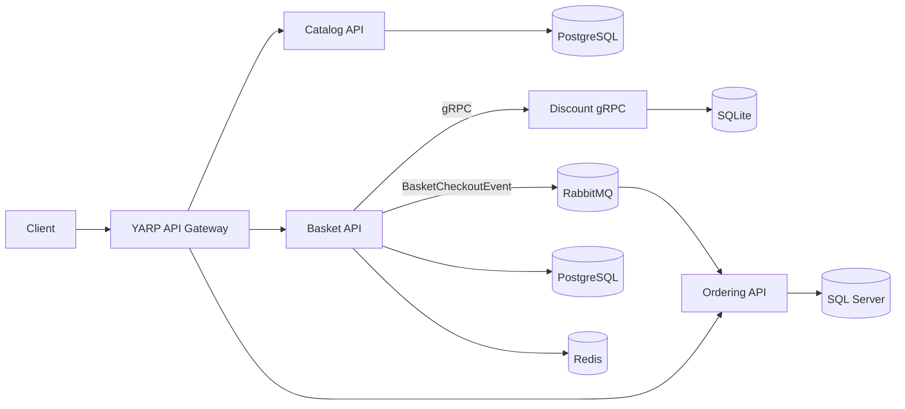

# EShop Microservices

An e-commerce backend built with a microservices architecture on .NET, using CQRS and event-driven communication.

> Based on the architecture from the course [Microservices Architecture and Implementation on .NET](https://www.udemy.com/course/microservices-architecture-and-implementation-on-dotnet).

## Architecture



| Service | Responsibility | Tech |
|---|---|---|
| Catalog | Product management | Marten, PostgreSQL, CQRS (MediatR) |
| Basket | Shopping cart and checkout | Marten, PostgreSQL, Redis cache |
| Discount | Discount calculation | gRPC, SQLite, EF Core |
| Ordering | Order processing | Clean Architecture, DDD, EF Core, SQL Server |
| API Gateway | Single entry point | YARP |

**Communication:** synchronous gRPC between Basket and Discount, and asynchronous events over RabbitMQ (MassTransit) between Basket and Ordering.

## Tech Stack

.NET 8, ASP.NET Core Web API, MediatR (CQRS), MassTransit, RabbitMQ, gRPC, YARP, PostgreSQL, SQL Server, Redis, Docker

## Getting Started

```bash
git clone https://github.com/Shehab241/EShopMicroservices.git
cd EShopMicroservices/src
docker compose up -d
```

Service URLs and ports are defined in `src/docker-compose.yml`.

## Project Structure

```
src/
├── ApiGateways/
│   └── YarpApiGateway/
├── BuildingBlocks/
├── Services/
│   ├── Catalog/
│   ├── Basket/
│   ├── Discount/
│   └── Ordering/
└── docker-compose.yml
```

## License

MIT
